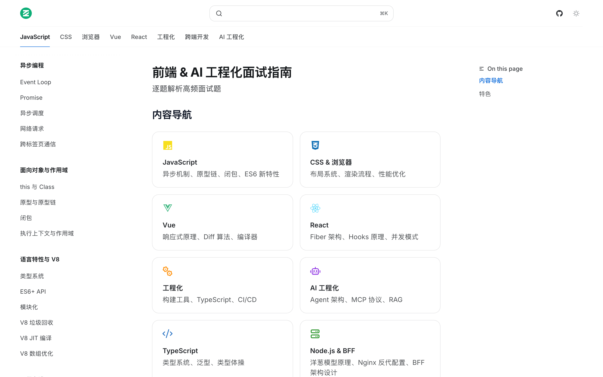
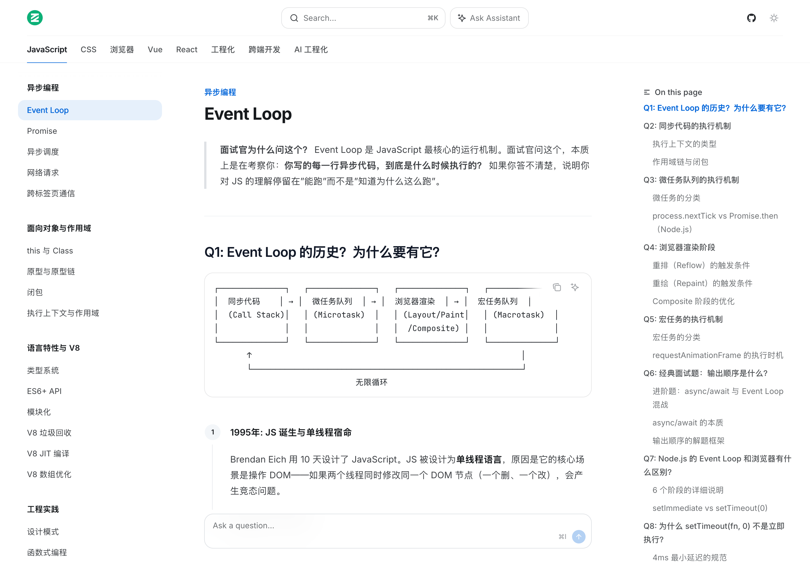

# Senior Frontend Interview Guide

English | [简体中文](./README.md)

👉 [Read Online](https://opc-43d279b8.mintlify.app)

> An interview handbook for senior frontend engineers focusing on underlying principles rather than API memorization. Covers the V8 engine, React/Vue source code, micro-frontend architecture, as well as AI Agent orchestration and large model engineering.

 

---

## Why This Project

- 🧠 **Karpathy-style RAG Architecture**: Adopting the `ingest → query → lint` knowledge base maintenance pattern, this project can be automatically updated by Agents like Claude Code and Cursor.
- ⚙️ **Focus on Underlying Mechanics, Not Definitions**: We don't just explain "what a closure is"; we explain "the memory layout of execution contexts and scope chains in V8".
- 🔗 **Traced to Authoritative Sources**: Deep dives are always traced back to specific experts (Dan Abramov, Harrison Chase, etc.) and infrastructure blogs from top tech companies, avoiding vague generalizations.
- 🤖 **AI Engineering Section**: Covers LLM token limits, RAG vector retrieval, Agent state snapshots, and the MCP protocol. Focuses on practical implementation rather than abstract concepts.
- 🚀 **LLM Retrieval Support**: Provides standard `[llms.txt](./llms.txt)` and `docs.json` indexes.

---

## Knowledge Structure

### JavaScript & V8 Engine

Underlying C++ implementation of Event Loop macro/microtask queues, execution context stack, closures, prototype chain, Orinoco GC, Ignition/TurboFan JIT compilation, and Hidden Classes.

### Frontend Frameworks

React: Fiber tree traversal, linked-list structure of Hooks, Lane model for concurrent scheduling. Vue: Reactive dependency collection, Patching & Diffing algorithms, template pre-compilation.

### Browser & Networking

Rendering pipeline (DOM → Style → Layout → Paint → Raster → Compositor, 16.6ms frame lifecycle), TCP congestion control, HTTP/2 multiplexing, HTTP/3 QUIC, and 0-RTT.

---

> Built with LLMs & 💻
